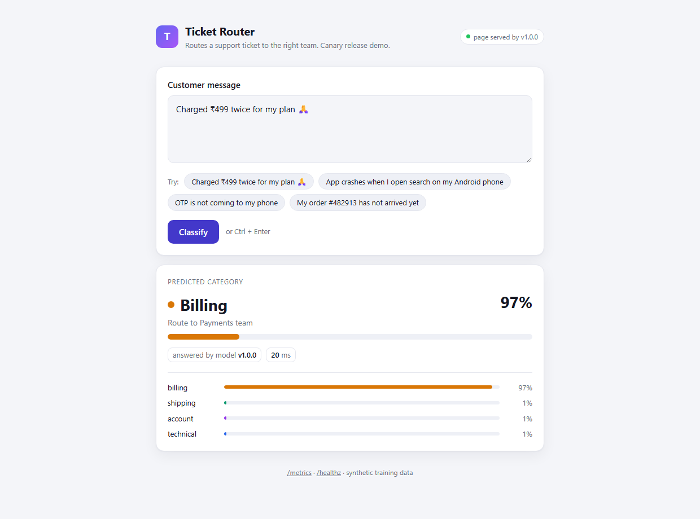
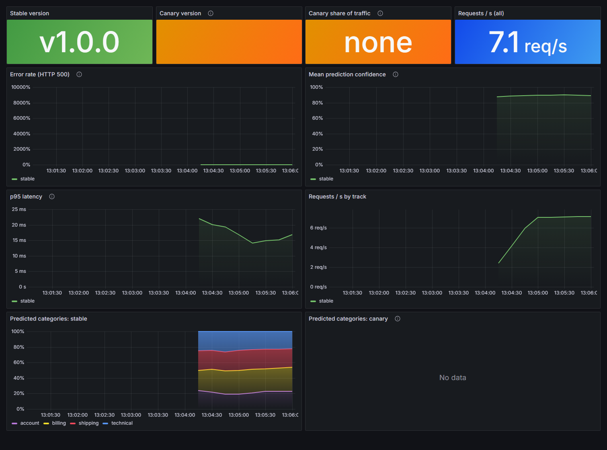
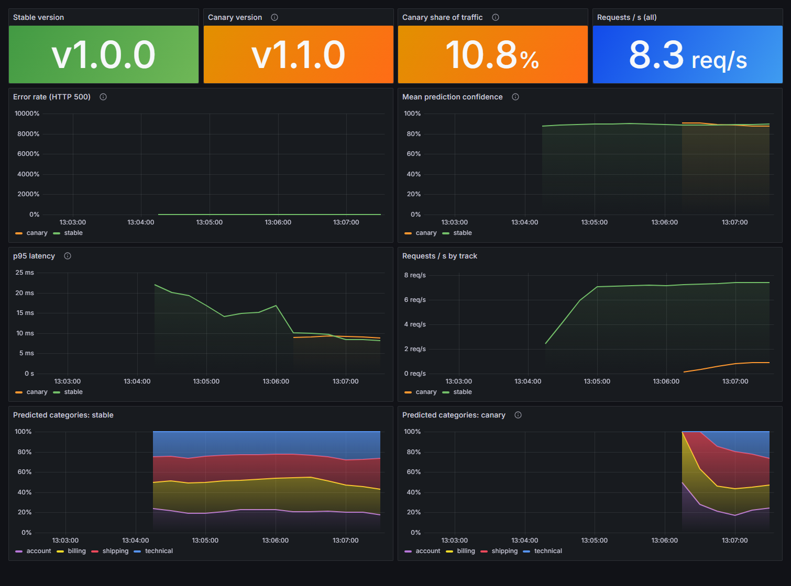
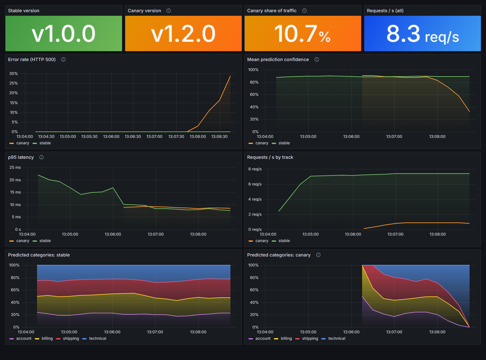
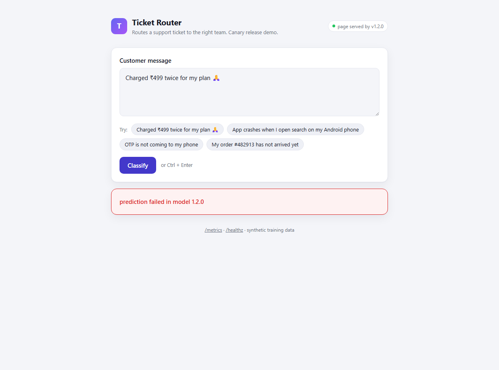

# Safer ML releases, one canary at a time

**What happens when a new model looks good in testing but breaks after deployment?**

This project explores that problem with a support-ticket classifier and a canary release: send a small share of traffic to a new version, compare it with the stable version, and decide whether to promote it or roll it back.


## Follow the release

**1. Start with a working experience.** A user submits a ticket and gets a category and confidence score. The demo uses synthetic ticket data.



**2. Establish the baseline.** Before comparing a new release, the dashboard shows the stable version's traffic, errors, latency and confidence.



**3. Try a healthy canary.** The new version receives a small share of test traffic. Its error rate and confidence remain close to the stable version.



**4. Introduce a fault.** An intentionally broken tokenizer causes errors and lower confidence in the canary while the stable version stays healthy.



**5. See the user impact.** A ticket containing a currency symbol exposes the faulty version's error.



## What was tested

In a local, native test on 15 November 2026:

- **6 unit tests passed.** A normally trained model reached **93.4%** accuracy on a synthetic held-out set; an intentionally degraded model scored **16.3%** and failed the accuracy gate.
- The canary checker returned **PROMOTE** for the healthy version after an 80-second shortened watch, and **ROLLBACK** for the faulty version after 60 seconds. The stable API was healthy after the faulty local canary was removed.

These are local test results, not production outcomes. The screenshots show the native demonstration; the full Jenkins-to-Kubernetes deployment, traffic routing, and automatic rollback have **not yet been verified end to end**. The data is synthetic, so the accuracy is not a claim about real customer tickets.

## How it works

A Jenkins pipeline is designed to test and build a model, deploy a canary alongside the stable version, and use Prometheus metrics-errors, latency and confidence-to decide whether to promote or roll back. Grafana makes those signals visible.

The documented local setup uses Docker Desktop, kind and kubectl. A public GitHub repository URL is needed for the Jenkins job.

```bash
bash start.sh
```

**[Explore the complete setup, architecture and test plan ->](SETUP.md)**

Have an idea for making the release safer or the demo easier to use? Open an issue or start a discussion.
