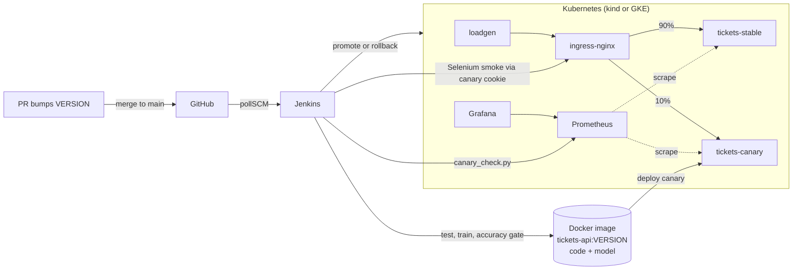

# Canary release with automatic rollback for an ML API

A new version of a support-ticket classifier gets 10% of live traffic on Kubernetes, and Jenkins promotes it or rolls it back on its own, based on Prometheus metrics.

**Result:** bad release rolled back `TBD after test run` minutes after merge; good release promoted `TBD after test run` minutes after merge.

**Demo video:** `TBD after recording`

## Architecture



## What each tool does

| Tool | Job in this project | Files |
|---|---|---|
| Git / GitHub | A merged PR that changes `VERSION` starts a release. Jenkins polls `main`. | `VERSION`, `Jenkinsfile` |
| Docker | One image per version with the API code and the model trained for it. Unit tests and training run as build stages. Rollback means the old image keeps serving. | `Dockerfile` |
| Jenkins | Declarative pipeline: build, unit tests, train, accuracy gate, push image, deploy canary, Selenium smoke, canary analysis, promote. Any failure rolls the canary back. No manual step. | `Jenkinsfile`, `jenkins/` |
| Selenium | Headless Chromium opens the demo page on the canary, submits a ticket, asserts that a category and the new version appear. | `tests/smoke_selenium.py` |
| Kubernetes + ingress-nginx | `tickets-stable` and `tickets-canary` Deployments and Services side by side. The canary Ingress has `canary-weight: "10"`. | `k8s/stable.yaml`, `k8s/canary.yaml` |
| Prometheus | Scrapes every API pod. Per-version request count, error count, latency histogram, confidence histogram, labelled `stable` / `canary`. | `k8s/monitoring.yaml`, `app/main.py` |
| Grafana | One provisioned dashboard: stable vs canary error rate, confidence, p95 latency, traffic, category mix. | `grafana/dashboard.json` |
| Terraform | Creates and destroys a zonal GKE cluster (2 spot e2-medium nodes) and an Artifact Registry repo. | `terraform/main.tf` |

The model is TF-IDF + logistic regression (scikit-learn) served by FastAPI. **The training data is synthetic**: `ml/data.py` builds tickets in four categories (billing, technical, account, shipping) from templates, with typos, mixed topics, Hindi/emoji sign-offs and 3% wrong labels. Run `python -m ml.data` to see samples. Accuracy is measured on a fixed held-out set (seed 999) and written to `metrics.json` in the image.

## Quick start (local, kind)

You need Docker Desktop, [kind](https://kind.sigs.k8s.io/), kubectl and Git Bash. Push this repo to your own GitHub account (public, branch `main`) so Jenkins can poll it.

```bash
./demo.sh up                                                    # kind cluster, ingress-nginx, Prometheus, Grafana, load generator
REPO_URL=https://github.com/<you>/<repo>.git ./demo.sh jenkins   # Jenkins in Docker, job created from jenkins/casc.yaml
```

Open Jenkins at http://localhost:8080 (admin / admin), open `canary-release`, click **Build Now** once. The first build has nothing to compare against, so `VERSION` 1.0.0 goes straight to stable. After that every push to `main` is picked up within a minute.

| What | URL |
|---|---|
| Demo page (through ingress) | http://localhost:8000 |
| Grafana dashboard | http://localhost:3000 |
| Prometheus | http://localhost:9090 |
| Jenkins | http://localhost:8080 |

Ship a normal release: open a PR that changes `VERSION` to `1.1.0`, merge it. Jenkins builds, deploys the canary at 10%, watches it for 5 minutes and promotes it.

Unit tests without Jenkins: `docker build --target test .`

Clean up: `./demo.sh down` (add `docker volume rm jenkins_home` to drop Jenkins history).

## GKE path

Needs `gcloud` (logged in) and Terraform. Only the cluster and registry differ from the local path; manifests, pipeline and dashboard are the same.

```bash
gcloud services enable container.googleapis.com artifactregistry.googleapis.com
terraform -chdir=terraform init
terraform -chdir=terraform apply -var project_id=<your-project>
./demo.sh gke        # add-ons on GKE, writes gke-kubeconfig for Jenkins, prints the next command
KUBECONFIG_FILE=gke-kubeconfig REGISTRY=<printed> INGRESS_URL=http://<printed-ip> REPO_URL=<your repo> ./demo.sh jenkins
kubectl port-forward svc/grafana 3000:3000   # dashboard at http://localhost:3000
```

The demo page is at the printed ingress IP. The Jenkins token lasts 24 hours and the registry login about one hour; re-run the two commands when they expire.

Tear down (delete the ingress first so its load balancer is not left behind):

```bash
kubectl delete namespace ingress-nginx
terraform -chdir=terraform destroy -var project_id=<your-project>
```

## The two failure demos

Both are ordinary PRs. Each changes `VERSION` and one `ARG` default in the `Dockerfile`.

**1. Weak model, stopped before deploy.** Set `ARG TRAIN_ARGS="--degrade"`. Training uses 40 rows with shuffled labels. The **Accuracy gate** stage compares the new `metrics.json` with the one inside the running stable image (`kubectl exec deploy/tickets-stable -- cat model/metrics.json`) and fails the build. No image is pushed and nothing changes in the cluster.

**2. Bad release, caught live and rolled back.** Set `ARG TOKENIZER=fast`. The model is unchanged, so the accuracy gate passes. But serving now uses a different tokenizer than training (`preprocess()` in `app/main.py`): it upper-cases text the model only saw lower-cased, and it crashes on non-ASCII input such as `?` or `???????`. This is a training/serving skew bug. The Selenium smoke test passes too, because an ASCII ticket still gets a category. Under real traffic, the canary's error rate goes up and its mean confidence drops. `scripts/canary_check.py` sees this against stable within its first checks and exits 1. Jenkins sets the canary weight to 0 and scales the canary to zero. Stable was never touched.

After each demo, revert the `ARG` line in a new PR with a new `VERSION`.

Canary thresholds are at the top of `scripts/canary_check.py`: watch 5 minutes, judge after 50 canary requests, roll back if the canary's error rate is 2 points above stable, p95 latency is 100 ms above stable, or mean confidence is below 85% of stable.

Note: ingress-nginx is retired upstream (maintenance ended March 2026). It is used here because its canary annotations are simple. Gateway API traffic splitting is the replacement.

## Test plan

A manual walk-through as a user. Screenshots go in `pictures/`.

1. Run `./demo.sh up`, then `./demo.sh jenkins`, then **Build Now**. Expect a green build with `mode bootstrap` in the log, and `kubectl get pods` showing 2 `tickets-stable` pods, Prometheus, Grafana and loadgen running.
   - Screenshot `pictures/jenkins-first-build.png`: the stage view of the first build.
2. Open http://localhost:8000. Click the example chips and type your own ticket. Expect a category, a confidence bar, the per-category scores and "answered by model v1.0.0".
   - Screenshot `pictures/demo-page.png`: a billing result.
3. Open http://localhost:3000. Expect stable lines on every panel, about 8 requests/s, and "none" for the canary version.
   - Screenshot `pictures/grafana-stable-only.png`.
4. Merge a PR that sets `VERSION` to `1.1.0`. Within a minute Jenkins starts. During **Canary analysis**, Grafana shows the canary at about 10% of traffic with error rate and confidence matching stable. After 5 minutes the log says `PROMOTE` and the stable version panel shows v1.1.0.
   - Screenshots `pictures/grafana-healthy-canary.png` and `pictures/jenkins-promote.png` (stage view plus the `PROMOTE` line).
5. Merge the demo 1 PR (`--degrade`, `VERSION` 1.1.1). Expect a red **Accuracy gate** stage with `FAIL` and no change in the cluster.
   - Screenshot `pictures/jenkins-accuracy-gate-fail.png`.

   Then merge a PR with `TRAIN_ARGS=""` and `VERSION` 1.1.2. Expect a normal promote.
6. Merge the demo 2 PR (`TOKENIZER=fast`, `VERSION` 1.2.0). Note the merge time. Watch Grafana: the canary error rate rises and its confidence falls while stable stays flat. In the browser dev tools, set the cookie `canary=always` on localhost:8000 and reload: the ? example chip shows an error from model 1.2.0. Expect a `ROLLBACK after ...s` line, the canary traffic share back to 0%, and stable still on v1.1.2. Write the time from merge to rollback into the result line at the top.
   - Screenshots `pictures/grafana-bad-canary.png`, `pictures/demo-page-canary-error.png`, `pictures/jenkins-rollback.png` (stage view plus the `ROLLBACK` line).
7. Revert with a PR setting `TOKENIZER=standard` and `VERSION` 1.2.1. Expect a normal promote.
8. Run `./demo.sh down`.
